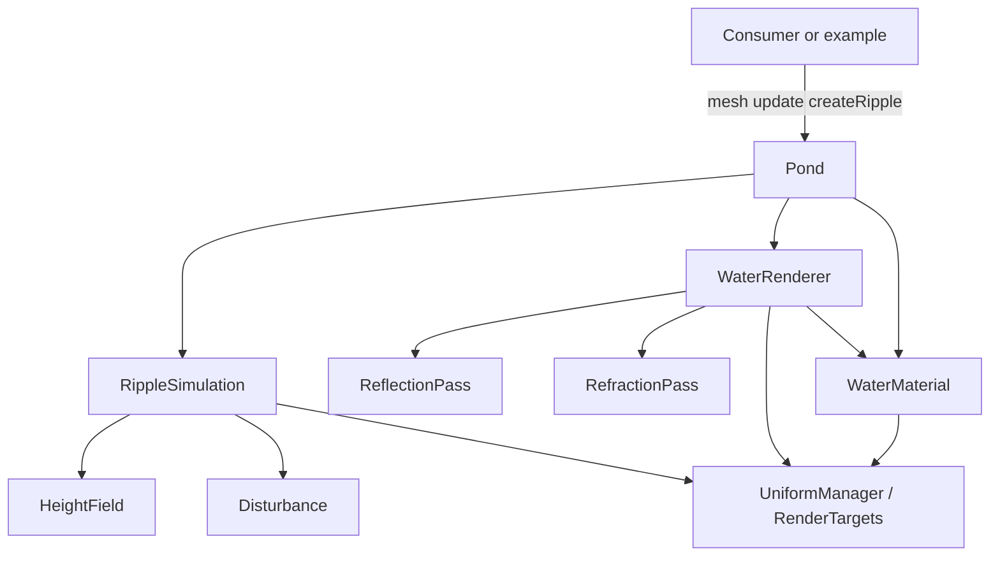

# threejs-water

Standalone, reusable **Three.js water library** in TypeScript.

This is **not** a game. It is a production-oriented water surface system you can copy or install into any vanilla Three.js project with a small public API.

> **Current status:** Phase 1–4 implemented — reflective/refractive water plane, GPU heightfield ripples, and interactive `createRipple`. Visual target inspired by [jeantimex/threejs-water](https://github.com/jeantimex/threejs-water) (without physics / caustics / pool SDF raytracing).

Visual inspiration: [jeantimex/threejs-water](https://github.com/jeantimex/threejs-water) (Evan Wallace–style heightfield water). This library intentionally omits physics, pool SDFs, caustics, and interactive floating objects.

---

## Public API

```ts
import { Pond } from 'threejs-water';

const pond = new Pond({
  width: 20,
  height: 20,
});

scene.add(pond.mesh);

function animate(delta: number) {
  pond.update(delta);
}

pond.createRipple(position);
pond.dispose();
```

Internal modules (`simulation/`, `rendering/`, `materials/`, `core/`, …) are **not** part of the public surface. Import only from the package root (`src/index.ts`).

---

## Quick start (example)

```bash
npm install
npm run dev
```

```bash
npm run typecheck
npm run build:lib   # library bundle → dist/
npm run build       # example app → dist-example/
```

- **Runtime peer:** `three` (>= 0.160)
- **Stack:** Vanilla Three.js, TypeScript, Vite, GLSL
- **No** React / R3F, physics engines, or UI frameworks

---

## Folder responsibilities

| Folder | Responsibility | Must not |
|--------|----------------|----------|
| `src/objects/` | Public façade (`Pond`) | Contain GLSL, RT ping-pong, or pass draw calls |
| `src/simulation/` | Ripple propagation and water state | Own materials or scene cameras |
| `src/rendering/` | Reflection / refraction passes | Own ripple math or public API |
| `src/materials/` | Shader materials and uniforms | Run simulation steps |
| `src/shaders/` | GLSL sources only | TypeScript logic |
| `src/core/` | RT helpers, uniform helpers, constants | Know about ponds or ripples |
| `src/utils/` | Pure helpers | Touch WebGL state |
| `src/types/` | Options / ripple types | Runtime behaviour |
| `src/resources/` | Static textures / assets | Code |
| `example/` | Demo host scene | Leak into the public API |

---

## Architecture



`Pond` **coordinates** subsystems. It does not implement rendering or simulation internals.

**Committed technical approach for later phases:**

- **Reflection / refraction:** scene-aware camera + render-target passes (not pool raytracing)
- **Ripples:** GPU ping-pong heightfield with disturbance stamps
- **`three`:** peer dependency

---

## Project layout

```text
src/
  objects/Pond.ts
  simulation/{RippleSimulation,HeightField,Disturbance}.ts
  rendering/{ReflectionPass,RefractionPass,WaterRenderer}.ts
  materials/WaterMaterial.ts
  shaders/{water,simulation,reflection,common}.*
  resources/textures/
  core/{UniformManager,RenderTargets,Constants}.ts
  utils/{Math,Helpers}.ts
  types/{WaterOptions,Ripple}.ts
  index.ts

example/
  main.ts
  scene.ts
  lights.ts
  terrain.ts
  camera.ts
```

---

## Implementation roadmap

| Phase | Scope |
|-------|--------|
| **0 (done)** | Folder structure, stub classes, types, public API, example host |
| **1 (done)** | Basic water plane, water material, animation |
| **2 (done)** | Reflection, refraction |
| **3 (done)** | Ripple simulation, height field |
| **4 (done)** | Interactive ripples, mouse interaction, `createRipple` GPU path |
| **5** | Depth-based colouring, shore blending, foam |
| **6** | Optimisation, resource management, performance |

---

## Design goals

- Small, stable public API suitable for an npm package
- SOLID boundaries — one responsibility per folder
- Easy to drop into other Three.js projects
- Extensible without forcing game-specific code into the library

---

## License

MIT
